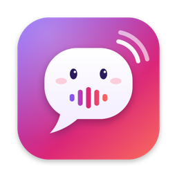
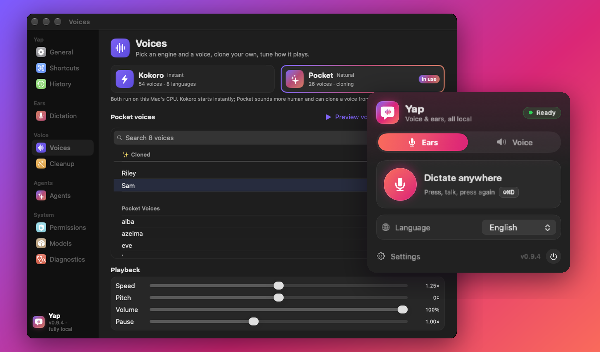
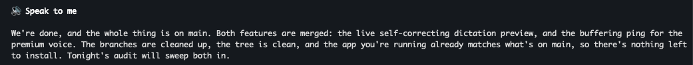

<div align="center">



# Yap

**Talk to your Mac. It talks back.**

Press a shortcut and talk: your words type themselves wherever the cursor is. Highlight anything and hear it read aloud in a natural voice. Give your AI agents the same voice and ears. All of it runs on your Mac, free and open source.

[Install](#install) · [How you use it](#how-you-use-it) · [Agents](#give-your-agents-a-voice) · [Privacy](#privacy)



</div>

## Install

```bash
brew install --cask latent-variable/tap/yap
```

Or grab `Yap-*.dmg` from [Releases](https://github.com/latent-variable/Yap/releases), drag it to Applications, and run `xattr -cr /Applications/Yap.app` once (it's open source, not notarized). Or build it: `git clone https://github.com/latent-variable/Yap.git && cd Yap && bash scripts/build_app.sh && open dist/Yap.app`.

First launch: download the Kokoro voice in **Settings ▸ Models** (~340 MB) and grant Microphone and Accessibility when asked. The app bundles its own Python, so there is nothing else to install.

## How you use it

| | Press | What happens |
|---|---|---|
| **Ears** | **⌘⇧D**, talk, **⌘⇧D** | A live preview floats while you talk. The accurate transcript is pasted at your cursor, in any app. |
| **Voice** | Select text, **⌘⇧R** | It reads aloud as it synthesizes. Pause, stop and change speed from the menu bar. |
| **Services** | Right-click ▸ **Read with Yap** | Same as Voice, from any app's context menu. |

Both shortcuts can be any chord, including a modifier-only one like ⌥⌘ held and released.

- **Dictation** runs NVIDIA Parakeet on the Apple Neural Engine: a fast streaming model for the live preview, an accurate one for the text it inserts. English, or 25 languages in multilingual mode. Everything you dictate is kept in Settings ▸ History, so a missed paste is never lost.
- **Two voice engines.** Kokoro: 54 voices in 8 languages, instant, on CPU. Pocket TTS (optional): 26 more natural voices, and **voice cloning** from a 20-second clip.
- **Cleanup before it speaks.** Markdown, code blocks, citations and URLs are stripped so you hear the words, not the punctuation.

Yap is a free alternative to the dictation features of [Wispr Flow Pro](https://wisprflow.ai/pricing), [Superwhisper Pro](https://ai.superwhisper.com/) and [MacWhisper Pro](https://goodsnooze.gumroad.com/l/macwhisper), and it reads aloud too.

## Give your agents a voice

Coding with an agent is mostly typing prompts and reading long replies. Yap removes both:

1. **Talk your prompt** into Claude Code, Codex or Cursor with ⌘⇧D.
2. **Listen to the answer.** Paste the block below into your agent's `AGENTS.md` or `CLAUDE.md`. Every reply then ends with a short spoken summary; select it and press ⌘⇧R.

```md
## 🔊 Speak to me
End every reply longer than a line with a spoken block I will listen to through text-to-speech. Its header says whether I have to act:

- `## 🔊 Speak to me · no input needed`: where the work stands and when it will be done.
- `## 🔊 Speak to me · decision needed`: what you need from me, what I need to understand to decide, the options counted out in words with what each costs, and which you would pick. One ask per reply.

Inside the block: plain spoken sentences only. No markdown, code, tables, links or symbols, because a voice reads them out literally. Spell out numbers and flags in words. Skip the block when the task asks for an exact machine format, like JSON, a diff or a commit message.
```

The same block, plus a simpler version, is in **Settings ▸ Agents** with a Copy button and a spoken example.



### Let agents speak and listen on their own

Yap also answers a small local API, so an agent, a script or a desktop companion can use the same voice and ears without you pressing anything:

```bash
ln -s /Applications/Yap.app/Contents/Resources/bin/yap /usr/local/bin/yap   # once
yap say "The build finished and all tests pass."
yap listen          # opens dictation, prints what you said
```

It is HTTP over a private socket in `~/Library/Application Support/Yap`, so no web page and no other user can reach it. Listening is off until you turn it on in **Settings ▸ Agents**, because it lets a program you run use Yap's microphone; the dictation window always shows while it listens. Every endpoint, with curl and Python examples: [docs/AGENT-API.md](docs/AGENT-API.md).

## Privacy

Everything runs on your Mac: no account, no telemetry, and your audio and text never leave it. **Accessibility** lets Yap read your selection and paste; **Microphone** feeds dictation. Don't want to grant Accessibility? Set **Read source** to Clipboard and copy text yourself.

Yap goes online only to download models (the dictation pair at launch while Dictation is on, Pocket's files when it loads, and anything you start in Settings) and for a once-a-day update check you can turn off. The full list is in [docs/PRIVACY.md](docs/PRIVACY.md).

Don't take my word for it. Point your coding agent at this repo and have it confirm nothing about you leaves the machine. If it holds up, a ⭐ helps.

> In terminals like iTerm, which don't expose their selection, **Auto** read source falls back to your clipboard. Highlighting there replaces what you'd copied, and pressing Read with nothing selected speaks the clipboard. Want strict selection only? Set **Read source** to Selected text.

## How it's built

```
SwiftUI menu-bar app ──HTTP──> local FastAPI sidecar ──┬─ Kokoro (ONNX, CPU)
  hotkeys · capture · cleanup · player                 └─ Pocket TTS (PyTorch, CPU)
  mic ──> FluidAudio · Parakeet (CoreML, Apple Neural Engine)   ← dictation, in-app
```

The voice runs in a local Python sidecar on `127.0.0.1`; dictation runs inside the app. Module map: [docs/ARCHITECTURE.md](docs/ARCHITECTURE.md).

```bash
bash scripts/build_app.sh && open dist/Yap.app                               # build + run
cd app && swift build && "$(swift build --show-bin-path)/Yap" --selftest   # Swift tests
cd backend && python -m pytest tests/ -q                                     # backend tests
```

## License

MIT. Kokoro weights Apache-2.0 (hexgrad/Kokoro-82M). Pocket TTS by [Kyutai](https://github.com/kyutai-labs/pocket-tts), CC-BY-4.0; Yap serves a byte-identical mirror of the cloning weights so no account is needed. Starter voices from CMU ARCTIC. Dictation uses [FluidAudio](https://github.com/FluidInference/FluidAudio) (Apache-2.0) running NVIDIA Parakeet. Clone only voices you have rights to.
